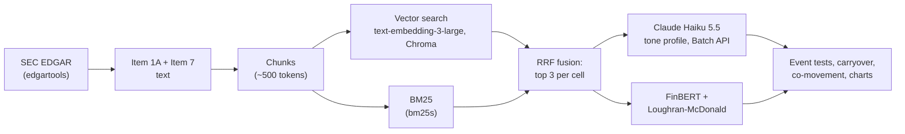

# SEC Filings Tone

How do S&P 500 companies write about AI, China, tariffs, interest rates and nine other topics in
their 10-Ks, and how did that change from FY2019 to FY2025? Polarity alone can't answer that. Risk
factors are negative by design: 86% of on-topic passages score −1. A risk can go from "export
controls could restrict sales" to named chips and a $4.5 billion charge while its polarity stays
negative. So an LLM scores a **tone profile** with five dimensions toward each topic: polarity,
magnitude, realization, uncertainty and specificity. FinBERT and the Loughran-McDonald dictionary
serve as baselines. The tests were fixed in advance, with later changes dated and both versions
kept. This page reports what passed and what didn't.

Full results: [RESULTS.md](RESULTS.md). Design log, with every decision and its date: [PLAN.md](PLAN.md).
Retrieval eval: [eval/FINDINGS.md](eval/FINDINGS.md).

## Research questions

1. How well do an LLM, FinBERT and the Loughran-McDonald dictionary score 10-K text, against
   labels and against real events? Does a profile with several dimensions measure anything polarity misses?
2. Does tone react to known shocks (COVID, chip export controls, rate hikes, SVB, the AI boom, the
   2025 tariffs) where they hit, and which dimension picks that up?
3. How much of a 10-K is copied from the year before, and does copied text score differently?
4. Do companies in the same sector move together?

## Key results

Numbers in brackets are 95% bootstrap intervals. These follow the "Key findings" in RESULTS.md as of
2026-10-17; that section was reframed after an external review.

- **The data.** Claude Haiku 5.5 scored 125,583 passages from 3,445 S&P 500 10-Ks (FY2019–FY2026) on
  five dimensions toward 13 topics, for $18.88. Its off-topic flag was right on all 11 gold passages
  it flagged. It is lenient the other way, though: it calls on topic many passages that never name
  the topic (over half of the early AI ones). So a word-checked version sits beside every affected result.
- **Little is validated against a person's labels.** On one person's blind labels, only
  **realization** (has it happened?) passes the agreement rule fixed in advance: weighted kappa 0.67
  [0.33, 0.88] on 20 items, against a bar of 0.6. The other four dimensions agree only after review
  toward the model's label. The model isn't detectably better than free word counts on any
  dimension. Realization comes closest, at +0.35 [−0.06, +0.76] in Spearman over a count of
  realization cues. Polarity can't be judged at all, since the model gives −1 to 18 of 20 items.
  Scored twice, **magnitude** misses the run-to-run bar fixed in advance (kappa 0.78, bar 0.8); it
  is kept by a decision made after seeing that result, since 0.78 is close to the bar.
- **The planned event test detects 2 of 11.** Each event's change is compared with the same change
  in sectors it didn't hit. Two expected changes pass, both for the rate hikes: magnitude +0.11
  [+0.01, +0.21] and specificity +0.11 [+0.02, +0.21]. The specificity result exists only because
  other sectors' specificity fell. A second check asks whether a change is a break rather than a
  trend already under way. It passes only for the 2025 tariffs, which reached every sector and so
  fail the comparison. No expected change passes both.
- **Before-after counts also pick up drift.** Where the event hit, the model moved as expected in
  **10 of 15** tests (9 of 15 with the tariff window corrected; 6 and 7 word-checked). FinBERT and
  the Loughran-McDonald dictionary managed **0 of 9**. But from FY2019 to FY2025, realization rose
  for 9 of 12 topics and polarity fell for all 12, event or not. Realization beat polarity in 4 of 6
  events before-after, but in none of the 4 that have a comparison group. The baselines score the
  whole passage, not the topic. And the scorer is told each filing's company and fiscal year, and
  the baselines aren't. So the event tests are free of labels but not of the model's knowledge.
  Rescoring 1,904 event-test passages with both masked changes per-passage scores no more than a
  second run does, and realization's changes hold. But COVID's rise in uncertainty falls from +0.21
  to +0.02: told "FY2019", the model scored pre-COVID text as calmer.
- **Other event caveats.** As filed, the 2025 tariff test compared FY2023 with FY2025 for 75% of
  companies. Corrected to one year, the realization difference from other sectors is +0.00 [−0.13,
  +0.12]. Which rule is primary is **pending** the owner's decision. The AI-boom test is selected on
  retrieval rank and isn't interpretable as designed. A follow-up on Financials' 10-Qs ($1.45)
  detected neither SVB nor the rate hikes in its planned tests (0 of 5).
- **What the data describes.** AI went from 8% to 93% of risk-factor sections (word-checked, FY2019 →
  FY2025). In FY2025, 80% of risk factors and 62% of MD&A were copied from the year before. New text
  is more realized than copied text but not more specific (slightly less in risk factors, within
  topic and year). So specificity measures concreteness, not novelty. Same-sector companies move
  together only negligibly (correlations higher by +0.003 to +0.007). Nearly all of a company's
  year-to-year change is its own, or noise.


*AI in 10-Ks, word-checked: the share of companies with an AI passage in risk factors went from 8% to
93% (FY2019 → FY2025). Where risk factors name AI, polarity went from −0.88 to −0.93. In MD&A, AI
stayed positive (+0.90 in FY2019, +0.88 in FY2025, on 20–76 companies).*


*Rate hikes, by year around the first hike. Financials' and Real Estate's magnitude jumped +0.14,
against +0.02 for the other companies. Realization rose in both groups alike (+0.13 and +0.09), from
drift or because the hikes reached every company's filings. The comparison with other sectors
removes a shared rise like that.*

## How it works



1. **Fetch** (`fetch.py`): 10-K Item 1A (Risk Factors) and Item 7 (MD&A) from SEC EDGAR via
   edgartools, FY2019 onward, for the current S&P 500 (498 companies after merging share classes).
2. **Chunk and embed** (`ingest.py`): heading-aligned chunks (500-token target, 800 maximum),
   embedded as plain text with `text-embedding-3-large` at 1,024 dimensions into Chroma. That gives
   673,902 chunks.
3. **Retrieve** (`retrieve.py`, `tone.py`): a *cell* is one company, one 10-K and one topic, such
   as NVDA × FY2023 × China. Each cell's passages are the top 3 from vector search plus BM25, fused
   with reciprocal rank fusion. Each topic has one fixed query. That gives 41,861 cells and 125,583
   passages.
4. **Score** (`sentiment.py`, `tone.py`): one Claude Haiku 5.5 call per passage, sent through the
   Message Batches API at half price. The prompt quotes the rules in
   [labels/guidelines.md](labels/guidelines.md) word for word. The model quotes its evidence before
   each score and sets an off-topic flag. A cell's tone is the mean over its on-topic passages. A cell
   with none counts as "topic not discussed", not as neutral.
5. **Baselines** on the same passages, scoring the whole passage: FinBERT polarity,
   Loughran-McDonald word shares, and counts of hedges, realization cues and details per 100 words.
6. **Analyses:** event tests against [events.csv](events.csv) (`events.py`), carryover from the
   year before with `difflib` (`diff.py`), sector co-movement (`comove.py`) and charts (`charts.py`,
   written to [figures/](figures/)).

| Dimension | Scale | Question | What it is not |
|---|---|---|---|
| Polarity | −2 to +2 | Does the topic help or hurt the company? | How big the effect is |
| Magnitude | 0–3 | How big is the effect? | Its direction; "material" in boilerplate doesn't count |
| Realization | 0–2 | Has it happened? (hypothetical, under way, happened) | How hedged the wording is |
| Uncertainty | 0–3 | How unpredictable are the effects? | Whether the event happened |
| Specificity | 0–2 | How concrete? (boilerplate, company-specific, named products, dates, amounts) | Whether it happened |

Twelve topics are scored for every company: supply chain, demand, China, interest rates, AI,
tariffs, government policy, inflation and costs, geopolitics and war, cybersecurity, labor and
workforce, and energy transition and climate. A thirteenth, deposits and liquidity, is scored for
Financials only.

## Methodology

- **Fixed in advance.** Every test, its expected direction and its decision rule went into PLAN.md
  before the result existed. That covers the events and directions in `events.csv`, the
  robustness checks, the co-movement test and the agreement bars (kappa 0.6 with people, 0.8 run to
  run). Changes made after seeing results are dated and give the reason. Both versions are kept
  (for example `events_v1.csv`).
- **Results reported against the rules.** By the label rule only realization would be kept. By the
  run-to-run rule magnitude would be dropped; it was kept by a dated decision after the result.
  Both are reported, not hidden.
- **Cost caps.** Every paid command takes `--budget` and stops before the first request if the
  estimate is over it. Scoring uses the Batch API and a cached guidelines prompt.
- **Word check.** The model's on-topic call is lenient for AI, China and tariffs. So every result on
  those topics is also run counting only passages that name the topic, and both versions are kept.
- **Recomputed with separate code:** the 10-Q event tests, the co-movement test (2,938 random
  pairs, identical), the cell retrieval (identical top 3 for all 355 cells of 4 companies) and the
  carryover matcher (within 0.2 points of an all-pairs comparison on four filings).
- **Spend.** Scoring all 125,583 passages cost $18.88, after a $0.05 smoke test on one company. The
  run-to-run check on 5,000 passages cost $0.79, the masked-prompt check on 1,904 $0.27, and the 10-Q
  follow-up $1.45. Embedding all 673,902 chunks cost $15.18, once.

## Retrieval eval

There are 50 test questions in `eval/tests.jsonl`, each with metadata filters, keywords copied from
the passages that answer it, and a reference answer. A chunk counts as relevant if it contains a
keyword as a whole word. Scores are on the top 10. This is the production check on all 498
companies (2026-10-15, $0.07):

| Stage | MRR | nDCG@10 |
|---|---|---|
| Vector search only | 0.764 | 0.675 |
| BM25 only | 0.671 | 0.638 |
| Hybrid (RRF) | 0.776 | 0.691 |
| Hybrid + Claude rerank | 0.910 | 0.805 |

- The questions were written at the start of the project, before any retrieval results were seen.
- The chunking and embedding setup was chosen on the first 30 questions (10 semiconductor
  companies), then rechecked on the other 20 before the full embed. The main finding: removing the
  overlap, the context header, or both from the embedded text made vector search clearly better
  (MRR 0.673 → 0.866 on the first 30).
- The research pipeline uses hybrid search's top 3 with fixed topic queries and no reranking. So this
  eval tests the retrieval layer, not the tone cells. The cells' quality is measured by the
  off-topic rate (24.7% of passages) and the word check.

## Data availability

**Coming: a GitHub release, data version 0.2.0, after a pending data fix.** It is not published yet.

The scored passages, cells, FinBERT and Loughran-McDonald baselines, carryover shares, human labels
and every result table will be released as versioned Parquet files (about 53 MB). The release's
`README.md` is a dataset card describing each file and column. Its `provenance.json` records the
scoring model, hashes of the prompt and output schema, and row counts. With it, every result in
RESULTS.md from the event tests on can be rerun locally, with no SEC download, embeddings or API calls. Rebuilding from scratch takes about 14 hours
of SEC fetching, roughly $35 of API calls and several hours of FinBERT. The final frozen version
will also go to Zenodo (with a DOI) and the Hugging Face Hub.

## Setup

Requires Python 3.13 or newer and [uv](https://docs.astral.sh/uv/). Run `uv sync`, then create a
`.env` file in the project root. The SEC rejects requests without a User-Agent.

```
SEC_USER_AGENT="Your Name your.email@example.com"
OPENAI_API_KEY=...       # embeddings and query embeddings
ANTHROPIC_API_KEY=...    # tone scoring and reranking
```

## Usage and reproduction

Each module runs as `uv run python -m sec_filings_tone.<module>`. Its docstring lists every option.
Commands marked "paid" call an API and take a `--budget` cap.

```bash
# Phase 1-2: fetch sections into data/cache/, chunk, embed (paid)
uv run python -m sec_filings_tone.fetch NVDA AMD         # or no tickers for the whole list
uv run python -m sec_filings_tone.ingest
uv run python -m sec_filings_tone.ingest --embed --batch --wait --budget 17 --no-rebuild

# Phase 3-4: search, and the retrieval eval
uv run python -m sec_filings_tone.retrieve "China export restrictions" --ticker NVDA --form 10-K --fy 2023 --item 1A
uv run python eval/eval.py

# Phase 9: passages per cell (free), scoring (paid), baselines (local, ~2.6 hours)
uv run python -m sec_filings_tone.tone retrieve
uv run python -m sec_filings_tone.tone score --budget 30
uv run python -m sec_filings_tone.tone baselines

# Phase 6: the scorer and baselines against the human labels
uv run python -m sec_filings_tone.sentiment gold-report [--adjudicated]
uv run python -m sec_filings_tone.sentiment gold-baselines

# Phase 7-9 analyses: free and local, seconds to minutes
uv run python -m sec_filings_tone.events             # also --named, --robust, --fyrule
uv run python -m sec_filings_tone.diff carryover
uv run python -m sec_filings_tone.diff report
uv run python -m sec_filings_tone.comove
uv run python -m sec_filings_tone.charts             # writes figures/

# Offline tests, no API calls
for f in tests/test_*.py; do uv run python $f; done
```

Results are written to `data/tone/`, which is not in git. The 10-Q commands are in RESULTS.md,
"Reproduce".

## Limitations

- **Survivorship bias.** Today's S&P 500 list is applied back to 2019. That leaves out companies that
  dropped out of the index or went bankrupt.
- **One labeler.** One person labeled the 40 gold items, with no second rater. The adjudicated
  labels lean toward the model, so they can't validate it.
- **The off-topic flag is lenient.** Before FY2023, 53–59% of the passages the model called on topic
  for AI contain no AI word. Word-checked versions exist only for AI, China and tariffs.
- **The scorer sees the company and fiscal year.** Masking both leaves realization's event changes
  intact but removes most of COVID's rise in uncertainty. Two thirds of passages name a year, the
  company or COVID in their own text anyway.
- **Short scales hit ceilings.** Realization and specificity have three levels. Where a topic was
  already live, as China was for chipmakers, they can't rise.
- **Fiscal years are as the companies label them.** Most end in December, but NVDA's ends in
  January. Charts use that fiscal-year label. Event windows compare the last 10-K *filed* before
  the event with the first 10-K whose fiscal year *ends* on or after it. A variant (`--fyrule`) takes
  the last fiscal year ending before the event instead.
- **Some numbers will shift slightly** after a pending fix to some companies' fiscal-year labels.
- **No claim that tone predicts returns.** The results describe how companies write about risk and
  performance.

## Status and roadmap

| Phase | What | Status |
|---|---|---|
| 1 | Fetch 10-K and 10-Q sections (`fetch.py`) | Done |
| 2 | Chunk and embed (`ingest.py`) | Done |
| 3 | Hybrid retrieval and reranking (`retrieve.py`) | Done |
| 4 | Retrieval eval and chunking experiment (`eval/`) | Done |
| 5 | Tone-profile scorer, FinBERT and LM baselines (`sentiment.py`) | Done |
| 6 | Gold labels (40 items) and agreement | Done; no more labeling |
| 7 | Event tests, robustness, 10-Q follow-up (`events.py`) | Done; 10-Q follow-up parked |
| 8 | Boilerplate vs new text (`diff.py`) | Done |
| 9 | Topic tone across years and sectors, co-movement (`tone.py`, `charts.py`, `comove.py`) | Done |
| 10 | Q&A layer over the retrieval | Planned |
| 11 | Publishing: README, data release, paper | In progress |

**Still pending:** the choice of tariff window rule and the fiscal-year fix (data version 0.2.0). AI retrieval within MD&A, which a valid
AI-boom test needs, is a priced option (about $1.30–1.55), not done.

## License

Code (`src/`, `tests/` and the Python scripts in `eval/`): [MIT](LICENSE). Data, labels, figures
and documentation: [CC BY 4.0](LICENSE-DATA). Text quoted from SEC filings stays the filers' own;
`LICENSE-DATA` lists what each license covers.
