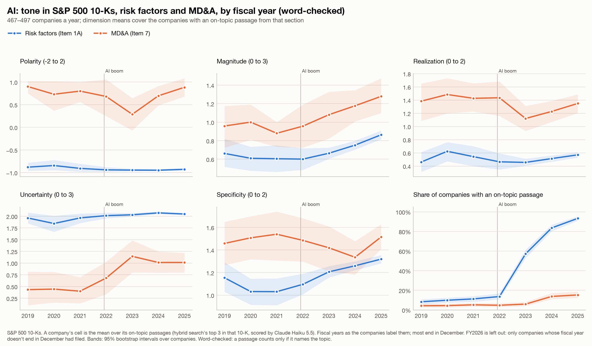
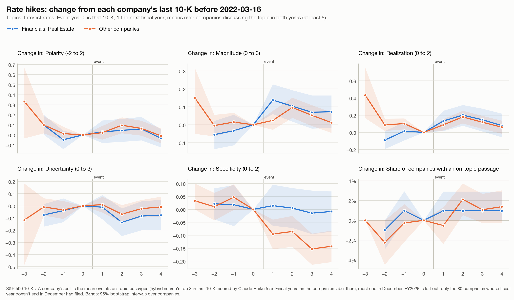
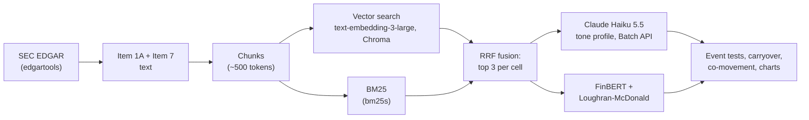
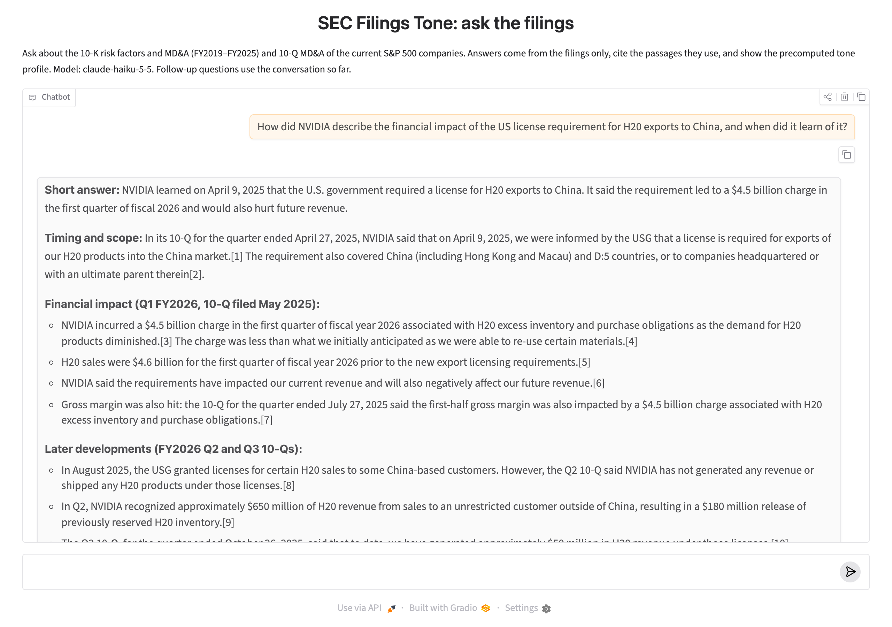

# SEC Filings Tone

[](https://doi.org/10.5281/zenodo.23683010)

**In short:** this project measures how S&P 500 companies write about 13 topics, such as AI, China
and tariffs, in their annual reports (10-Ks) from FY2019 to FY2026, and its 126,051 scored passages
will be released as a dataset. Two parts of the measurement hold up against one person's labels:
when the model says a passage isn't about the topic, it was right every time (11 of 11), and its
realization score (has the risk already happened?) agrees with the person's. The other four scores
aren't validated, and the main test, whether tone moved more where a known event such as COVID or
the 2023 bank failures hit than elsewhere, comes out mostly null.

How do S&P 500 companies write about AI, China, tariffs, interest rates and nine other topics in
their 10-Ks, and how did that change from FY2019 to FY2025? Polarity alone can't answer that. Risk
factors are negative by design: 86% of on-topic passages score −1. A risk can go from "export
controls could restrict sales" to named chips and a $4.5 billion charge while its polarity stays
negative. So an LLM scores a **tone profile** with five dimensions toward each topic: polarity,
magnitude, realization, uncertainty and specificity. FinBERT and the Loughran-McDonald dictionary
serve as baselines. The tests were fixed in advance, with later changes dated and both versions
kept. This page reports what passed and what didn't.

Full results: [RESULTS.md](RESULTS.md). Design log, with every decision and its date: [PLAN.md](https://github.com/milosandonov/sec-filings-tone/blob/5954d50662d72c42d8b4583764022588c27edffb/PLAN.md)
(archived in git history; the working tree no longer carries it).
Retrieval eval: [eval/FINDINGS.md](eval/FINDINGS.md).

https://github.com/user-attachments/assets/c9b0b72c-593c-4c9d-bc81-25b5074d4377

*90-second demo: the explorer's heatmaps, a click through to the passages and
evidence behind one cell, and a cited answer from the Q&A app. Recorded 2026-10-27 with a scripted browser.*

## Research questions

1. How well do an LLM, FinBERT and the Loughran-McDonald dictionary score 10-K text, against
   labels and against real events? Does a profile with several dimensions measure anything polarity misses?
2. Does tone react to known shocks (COVID, chip export controls, rate hikes, SVB, the AI boom, the
   2025 tariffs) where they hit, and which dimension picks that up?
3. How much of a 10-K is copied from the year before, and does copied text score differently?
4. Do companies in the same sector move together?

## Key results

Numbers in brackets are 95% bootstrap intervals. These follow the "Key findings" in RESULTS.md as of
2026-10-18: reframed after an external review, then updated for the fiscal-year fix and the one-year
event rule.

- **The data.** Claude Haiku 5.5 scored 126,051 passages from 3,458 S&P 500 10-Ks (FY2019–FY2026) on
  five dimensions toward 13 topics, for $18.94. Its off-topic flag was right on all 11 gold passages
  it flagged. It is lenient the other way, though: it calls on topic many passages that never name
  the topic (over half of the early AI ones). So a word-checked version sits beside every affected result.
- **Little is validated against a person's labels.** On one person's blind labels, only
  **realization** (has it happened?) passes the agreement rule fixed in advance: weighted kappa 0.67
  [0.33, 0.88] on 20 items, against a bar of 0.6. The other four dimensions agree only after review
  toward the model's label. The model isn't detectably better than free word counts on any
  dimension. Realization comes closest, at +0.35 [−0.06, +0.76] in Spearman over a count of
  realization cues. Polarity can't be judged at all, since the model gives −1 to 18 of 20 items.
  Scored twice, **magnitude** misses the run-to-run bar fixed in advance (kappa 0.78, bar 0.8); it
  is kept by a decision made after seeing that result, since 0.78 is close to the bar.
- **The planned event test detects 0 of 11.** Each event's change is compared with the same change
  in sectors it didn't hit. Each test is one-sided at 2.5%, so chance alone would pass about 0.3 of
  11. The closest are two rate-hike differences, borderline in every version
  (p = 0.04–0.07): magnitude +0.09 [−0.005, +0.19] and specificity +0.10 [−0.0001, +0.20]. The
  specificity gap comes from other sectors' specificity falling. Under the old filed rule both pass
  (2 of 11). A second check asks whether a change is a break rather than a trend already under way.
  It passes for 3 of 13, against about 0.3 by chance: COVID realization, on only the 21 companies
  whose fiscal year ended in early 2020 (the only ones with a year before), export-control polarity
  (18 chipmakers) and tariff realization (163 companies). The tests share companies, so these chance
  rates are rough. The tariffs reached every sector, so that one fails the comparison. No expected
  change passes both.
- **Before-after counts also pick up drift.** Where the event hit, the model moved as expected in
  **9 of 15** tests (10 under the filed rule; word-checked 6 and 6). FinBERT and the
  Loughran-McDonald dictionary managed **0 of 9**. But from FY2019 to FY2025, realization rose for 9
  of 12 topics and polarity fell for all 12, event or not. Realization beat polarity in 4 of 6
  events before-after, but in none of the 4 that have a comparison group. The baselines score the
  whole passage, not the topic. And the scorer is told each filing's company and fiscal year, and
  the baselines aren't. So the event tests are free of labels but not of the model's knowledge.
  Masked, on 1,903 event-test passages (a sample drawn under the old filed rule), scores agree with
  the originals about as well as a second run does, and realization's changes hold. But COVID's rise
  in uncertainty falls from +0.21 to +0.02: told "FY2019", the model scored pre-COVID text as calmer.
- **Other event caveats.** "Before" is now the last 10-K whose fiscal year ended before the event
  (the owner's decision, 2026-10-17, after the results). The old filed rule, kept as
  `events.py --filed`, compared FY2023 with FY2025 for 75% of companies in the 2025 tariff test. With
  one year, the tariffs' realization difference from other sectors is +0.00 [−0.12, +0.13]. The
  AI-boom test now searches each MD&A on its own ($0.85; before, it was selected on retrieval rank).
  AI polarity and specificity rose in IT and Communication Services MD&A, but nearly as much
  elsewhere: differences +0.11 and +0.09, n.s., on 38 companies against 40. A follow-up on
  Financials' 10-Qs ($1.45) detected neither SVB nor the rate hikes in its planned tests (0 of 5).
- **New text only (exploratory, 2026-10-26).** Most of a 10-K is copied from the year before, which
  could hide a reaction. Rerun on each cell's top 3 among passages not copied from the year before
  ($1.77), the event tests pass 1 of 11 in each version, about what chance gives. With fewer,
  self-selected companies and intervals 2–4 times wider, it neither supports nor rules out the idea
  that copied text hides a reaction (RESULTS.md, section 8).
- **What the data describes.** AI went from 8% to 93% of risk-factor sections (word-checked, FY2019 →
  FY2025). In FY2025, 80% of risk factors and 62% of MD&A were copied from the year before. New text
  is more realized than copied text but not more specific (slightly less in risk factors, within
  topic and year). So specificity measures concreteness, not novelty. Same-sector companies move
  together only negligibly (correlations higher by +0.003 to +0.007). Nearly all of a company's
  year-to-year change is its own, or noise.
- **Topics the 13 miss (exploratory, 2026-10-26).** Clustering every risk-factor chunk of FY2019–FY2025
  (k-means on the stored embeddings, k = 80) shows the fastest-growing themes (AI, cybersecurity, ESG,
  climate, talent) are already topics. What the topics miss and grew is mostly form: risk-factor
  summaries went from 25% to 55% of companies, and exclusive-forum clauses grew too. Acquisition, IP and
  crypto risks grew modestly. GLP-1 drugs and stablecoins are too rare for a cluster of their own
  (RESULTS.md, section 10; `figures/discovered_topics.png`).



*AI in 10-Ks, word-checked: the share of companies with an AI passage in risk factors went from 8% to
93% (FY2019 → FY2025). Where risk factors name AI, polarity went from −0.88 to −0.93. In MD&A, searched on
its own, AI stayed positive (+0.73 in FY2019, +0.60 in FY2025, on 28–170 companies).*



*Rate hikes, by year around the first hike. Financials' and Real Estate's magnitude jumped +0.14,
against +0.04 for the other companies. Realization rose in both groups alike (+0.13 and +0.12), from
drift or because the hikes reached every company's filings. The comparison with other sectors
removes a shared rise like that.*

## How it works



1. **Fetch** (`fetch.py`): 10-K Item 1A (Risk Factors) and Item 7 (MD&A) from SEC EDGAR via
   edgartools, FY2019 onward, for the current S&P 500 (498 companies after merging share classes).
2. **Chunk and embed** (`ingest.py`): heading-aligned chunks (500-token target, 800 maximum),
   embedded as plain text with `text-embedding-3-large` at 1,024 dimensions into Chroma. That gives
   674,816 chunks.
3. **Retrieve** (`retrieve.py`, `tone.py`): a *cell* is one company, one 10-K and one topic, such
   as NVDA × FY2023 × China. Each cell's passages are the top 3 from vector search plus BM25, fused
   with reciprocal rank fusion. Each topic has one fixed query. That gives 42,017 cells and 126,051
   passages. For AI in MD&A-only analyses, a cell is the top 3 within that 10-K's MD&A instead
   (10,308 passages), so MD&A text needn't out-rank the risk factors.
4. **Score** (`sentiment.py`, `tone.py`): one Claude Haiku 5.5 call per passage, sent through the
   Message Batches API at half price. The prompt quotes the rules in
   [labels/guidelines.md](labels/guidelines.md) word for word. The model quotes its evidence before
   each score and sets an off-topic flag. A cell's tone is the mean over its on-topic passages. A cell
   with none counts as "topic not discussed", not as neutral.
5. **Baselines** on the same passages, scoring the whole passage: FinBERT polarity,
   Loughran-McDonald word shares, and counts of hedges, realization cues and details per 100 words.
6. **Analyses:** event tests against [events.csv](events.csv) (`events.py`), carryover from the
   year before with `difflib` (`diff.py`), sector co-movement (`comove.py`) and charts (`charts.py`,
   written to [figures/](figures/)).

| Dimension | Scale | Question | What it is not |
|---|---|---|---|
| Polarity | −2 to +2 | Does the topic help or hurt the company? | How big the effect is |
| Magnitude | 0–3 | How big is the effect? | Its direction; "material" in boilerplate doesn't count |
| Realization | 0–2 | Has it happened? (hypothetical, under way, happened) | How hedged the wording is |
| Uncertainty | 0–3 | How unpredictable are the effects? | Whether the event happened |
| Specificity | 0–2 | How concrete? (boilerplate, company-specific, named products, dates, amounts) | Whether it happened |

Twelve topics are scored for every company: supply chain, demand, China, interest rates, AI,
tariffs, government policy, inflation and costs, geopolitics and war, cybersecurity, labor and
workforce, and energy transition and climate. A thirteenth, deposits and liquidity, is scored for
Financials only.

## Methodology

- **Fixed in advance.** Every test, its expected direction and its decision rule went into the design log,
  [PLAN.md](https://github.com/milosandonov/sec-filings-tone/blob/5954d50662d72c42d8b4583764022588c27edffb/PLAN.md), before the result existed; its dated
  entries and their commits show the order. That covers the events and directions in `events.csv`, the
  robustness checks, the co-movement test and the agreement bars (kappa 0.6 with people, 0.8 run to
  run). Changes made after seeing results are dated and give the reason. Both versions are kept
  (for example [`events_v1.csv`](https://huggingface.co/datasets/milosand1/sec-filings-tone/blob/main/results/events_v1.csv)
  in the data release, and the filed event rule as `--filed`).
- **Results reported against the rules.** By the label rule only realization would be kept. By the
  run-to-run rule magnitude would be dropped; it was kept by a dated decision after the result.
  Both are reported, not hidden.
- **Cost caps.** Every paid command takes `--budget` and stops before the first request if the
  estimate is over it. Scoring uses the Batch API and a cached guidelines prompt.
- **Word check.** The model's on-topic call is lenient for AI, China and tariffs. So every result on
  those topics is also run counting only passages that name the topic, and both versions are kept.
- **Recomputed with separate code:** the 10-Q event tests, the co-movement test (2,938 random
  pairs, identical), the cell retrieval (identical top 3 for all 355 cells of 4 companies), the
  MD&A-only AI cells (200 random cells identical) and their AI-boom test (every estimate identical),
  and the carryover matcher (within 0.2 points of an all-pairs comparison on four filings).
- **Spend.** The kept scores for all 126,051 passages cost $18.94 ($19.09 paid in all, including
  $0.21 to rescore after the fiscal-year fix). The run-to-run check on 5,000 passages cost $0.79,
  the masked-prompt check $0.27, the 10-Q follow-up $1.45 and the MD&A-only AI cells $0.85. Embedding cost $15.18, plus about
  $0.05 for the 914 chunks the fiscal-year fix added.

## Retrieval eval

There are 50 test questions in `eval/tests.jsonl`, each with metadata filters, keywords copied from
the passages that answer it, and a reference answer. A chunk counts as relevant if it contains a
keyword as a whole word. Scores are on the top 10. MRR and nDCG are computed for each keyword and
averaged per question, then over questions, so MRR is the mean reciprocal rank of the first chunk
naming each keyword, not of one answer chunk per question. On all 498 companies, rerun without
reranking on 2026-10-18; the reranked row is the production check of 2026-10-15 ($0.07):

| Stage | MRR | nDCG@10 |
|---|---|---|
| Vector search only | 0.764 | 0.675 |
| BM25 only | 0.667 | 0.635 |
| Hybrid (RRF) | 0.776 | 0.692 |
| Hybrid + Claude rerank (2026-10-15) | 0.910 | 0.805 |

- The 2026-10-15 run had BM25 at 0.671 / 0.638 and hybrid nDCG at 0.691. The cause of the
  difference wasn't found: the same code, test file and library versions give 0.667 on the chunks
  from before the fiscal-year fix too.

- The questions were written at the start of the project, before any retrieval results were seen.
- The chunking and embedding setup was chosen on the first 30 questions (10 semiconductor
  companies), then rechecked on the other 20 before the full embed. The main finding: removing the
  overlap, the context header, or both from the embedded text made vector search clearly better
  (MRR 0.673 → 0.866 on the first 30).
- The research pipeline uses hybrid search's top 3 with fixed topic queries and no reranking. So this
  eval tests the retrieval layer, not the tone cells. The cells' quality is measured by the
  off-topic rate (24.8% of passages) and the word check.

## Q&A demo

A local chat window (`uv run python -m sec_filings_tone.app`) answers questions about any company,
sector or year from the filings. Each turn, Claude Haiku 5.5 plans the search (follow-ups rewritten,
multi-part questions split, companies and years turned into filters), the reranked hybrid search
finds the passages, and the answer cites them through the API's citations. "Which companies / which
sectors" questions are answered from the tone cells instead, since a search returns only a few
passages. Under each answer: the cited spans, the tone profile of the cells it draws on with the
change from the year before, and the cost. It declines predictions and questions outside the data.



An excerpt of that answer, copied from the run (2026-10-18, $0.0054); the bracketed numbers point
to the cited spans listed under it:

> **Q:** How did NVIDIA describe the financial impact of the US license requirement for H20 exports
> to China, and when did it learn of it?
>
> **Short answer:** NVIDIA learned on April 9, 2025 that the U.S. government required a license for
> H20 exports to China. It said the requirement led to a $4.5 billion charge in the first quarter of
> fiscal 2026 and would also hurt future revenue. […]
>
> NVIDIA incurred a $4.5 billion charge in the first quarter of fiscal year 2026 associated with H20
> excess inventory and purchase obligations as the demand for H20 products diminished.[3] […]
> H20 sales were $4.6 billion for the first quarter of fiscal year 2026 prior to the new export
> licensing requirements.[5]

**Eval** (69 questions in `eval/qa_tests.jsonl`, bars fixed in advance; details in
[eval/FINDINGS.md](eval/FINDINGS.md) section 9). Answers cost $0.0039 a question on average and
took a median 21 seconds in that run, most of it Chroma's filtered search. Since 2026-10-26 the app
searches the stored vectors exactly instead: on the eval's 82 sub-queries it gives the reranker the same
candidates as Chroma (all 81 that match any chunk), and a search takes a median 0.11 seconds instead of 3.9.
Asked the 69 eval questions again with it (answers only, $0.27, 2026-10-26), the median answer took
11 seconds instead of 21.

The first run met one of four bars. A rerun on 2026-10-26 had stricter answer rules (every sentence
cites a passage; no claims about what the filings leave out), period ends in the source titles and a
planner fix for wrongly declined questions. The changes were designed from the first run's own failures,
so the gain is in-sample. Both runs are kept:

| Metric | First run (2026-10-18) | Rerun (2026-10-26) | Bar |
|---|---|---|---|
| Out-of-scope questions declined | 5 of 5 | 5 of 5 | ≥ 80%: met |
| Planner tickers / fiscal years right | 83% / 54% | 92% / 47% | ≥ 90% |
| Judge groundedness (Claude Sonnet 5.5, 1–5) | 3.89 | 4.48 | ≥ 4: met in the rerun |
| Answers with a claim the judge calls unsupported | 78% | 38% | ≤ 5%: missed |
| Answerable questions wrongly declined | 7 of 64 | 1 of 64 | |
| Cited spans found in their passage | 417 of 417 | 388 of 388 | |
| Judge accuracy / completeness (1–5) | 4.09 / 4.08 | 4.67 / 4.39 | |

Paired over the same 64 judged questions, the unsupported share fell by 41 points [−55, −27] and
groundedness rose by 0.59 [+0.38, +0.81]. The planner gives different plans from run to run (the same plan
on only 28 of 69 questions in two runs), so its row isn't attributed to the changes. The judge seeing the
new titles explains about 1.6 of the 41 points [0.3, 5.3] (re-judging 10 first-run answers with them). A
sentence-by-sentence check was tried and removed: with and without it the scores can't be told apart.
What's left of the unsupported claims is mostly interpretations the judge calls loose, plus a few real
errors (eval/FINDINGS.md section 9).

In the first run the planner declined 7 answerable questions that name a company outside the index or ask
for one figure. The fiscal-year bar is partly a test artefact: the expected filters come from the retrieval
eval, and many questions don't name the year. Many claims the judge calls unsupported are statements
about what the passages don't say, or facts the answer model had and the judge didn't. No person
has graded the answers, and the reference answers haven't been reviewed.

## Data availability

**On the Hugging Face Hub: [milosand1/sec-filings-tone](https://huggingface.co/datasets/milosand1/sec-filings-tone),
data version 0.4.0** (published 2026-10-18, CC BY 4.0; third-party parts keep their own terms, as the card lists).

The scored passages, cells, FinBERT and Loughran-McDonald baselines, carryover shares, human labels
and every result table are there as versioned Parquet files (about 26 MB). So are the whole corpus
(674,816 chunks, 159 MB) and its embeddings with the topic query vectors (2.5 GB): with these, the
retrieval can be redone exactly without fetching filings or calling an embedding API. Its `README.md` is a
dataset card describing each file and column. Its `provenance.json` records the
scoring model, hashes of the prompt and output schema, and row counts. With it, every result in
RESULTS.md from the event tests on can be rerun locally, with no SEC download, embeddings or API
calls. Rebuilding from scratch takes about 14 hours of SEC fetching, roughly $35 of API calls and
several hours of FinBERT. The final frozen data version (1.0.0) will also go to Zenodo, with a DOI.

## Setup

Requires Python 3.13 or newer and [uv](https://docs.astral.sh/uv/). Run `uv sync` (add `--extra finbert`
for the FinBERT baselines, `--extra app` for the chat app and the explorer, or `--all-extras`), then create a
`.env` file in the project root. The SEC rejects requests without a User-Agent.

```
SEC_USER_AGENT="Your Name your.email@example.com"
OPENAI_API_KEY=...       # embeddings and query embeddings
ANTHROPIC_API_KEY=...    # tone scoring and reranking
```

## Usage and reproduction

Each module runs as `uv run python -m sec_filings_tone.<module>`. Its docstring lists every option.
Commands marked "paid" call an API and take a `--budget` cap.

```bash
# Phase 1-2: fetch sections into data/cache/, chunk, embed (paid)
uv run python -m sec_filings_tone.fetch NVDA AMD         # or no tickers for the whole list
uv run python -m sec_filings_tone.ingest
uv run python -m sec_filings_tone.ingest --embed --batch --wait --budget 17 --no-rebuild

# Phase 3-4: search, and the retrieval eval
uv run python -m sec_filings_tone.retrieve "China export restrictions" --ticker NVDA --form 10-K --fy 2023 --item 1A
uv run python eval/eval.py

# Phase 9: passages per cell (free), scoring (paid), baselines (local, ~2.6 hours)
uv run python -m sec_filings_tone.tone retrieve
uv run python -m sec_filings_tone.tone score --budget 30
uv run python -m sec_filings_tone.tone baselines
uv run python -m sec_filings_tone.tone retrieve --section   # AI within each MD&A; then score --section --budget 2, baselines --section

# Phase 6: the scorer and baselines against the human labels
uv run python -m sec_filings_tone.sentiment gold-report [--adjudicated]
uv run python -m sec_filings_tone.sentiment gold-baselines

# Phase 7-9 analyses: free and local, seconds to minutes
uv run python -m sec_filings_tone.events             # also --named, --robust, --filed
uv run python -m sec_filings_tone.diff carryover
uv run python -m sec_filings_tone.diff report
uv run python -m sec_filings_tone.comove
uv run python -m sec_filings_tone.charts             # writes figures/

# Phase 10: Q&A with cited passages (paid, cents a question; $0.50 cap per session by default)
uv run python -m sec_filings_tone.answer "What charge did NVIDIA record for H20 exports to China?"
uv run python -m sec_filings_tone.app                # local chat window at http://127.0.0.1:7860
uv run python -m sec_filings_tone.explore            # free: heatmaps of the cells, click through to passages, http://127.0.0.1:7861
uv run python eval/qa_eval.py answers --budget 0.70   # the Q&A eval (paid), then: judge --budget 1.25, report
                                                      # (the 2026-10-26 rerun: eval/FINDINGS.md, "How to reproduce")

# Exploratory (2026-10-26): event tests on new text only, and topic discovery
uv run python -m sec_filings_tone.diff retrieve        # new-text cells' passages; free
uv run python -m sec_filings_tone.diff score --budget 2   # paid (about $1.77); --budget 0 shows count and cost
uv run python -m sec_filings_tone.diff events          # event tests and break check on them
uv run python -m sec_filings_tone.discover             # clusters, tables, chart; free (--name --budget 0.1: Haiku names)

# Offline tests, no API calls
uv run pytest
```

Settings shared across the pipeline (model ids, prices, paths, fiscal-year bounds, batch limits) are in
`src/sec_filings_tone/config.py`. Each command loads `.env` when it starts; to call the library from Python
with the API, call `dotenv.load_dotenv()` first. Every paid command appends one JSON line to `data/runs.jsonl` (local, not in git): the command, commit,
models, prompt hashes, USD per provider, counts, batch ids, outputs and status, also for stopped or failed
runs. Results are written to `data/tone/`, which is not in git. The 10-Q commands are in RESULTS.md,
"Reproduce".

## Limitations

- **Survivorship bias.** Today's S&P 500 list is applied back to 2019. That leaves out companies that
  dropped out of the index or went bankrupt.
- **One labeler.** One person labeled the 40 gold items, with no second rater. The adjudicated
  labels lean toward the model, so they can't validate it.
- **The off-topic flag is lenient.** Before FY2023, 52–58% of the passages the model called on topic
  for AI contain no AI word. Word-checked versions exist only for AI, China and tariffs.
- **The scorer sees the company and fiscal year.** Masking both leaves realization's event changes
  intact but removes most of COVID's rise in uncertainty. Two thirds of passages name a year, the
  company or COVID in their own text anyway.
- **Short scales hit ceilings.** Realization and specificity have three levels. Where a topic was
  already live, as China was for chipmakers, they can't rise.
- **A fiscal year is labelled by the calendar year it ends in.** Most end in December, and a
  52/53-week year ending January 1–7 counts as the year before. But 43 companies (9% of the
  FY2019–FY2025 10-Ks) end their year between January 8 and May 31, so their FY t mostly covers
  calendar t−1: NVDA's FY2024 ended in January 2024. Some retailers (HD, LOW, TGT) name that year by
  the earlier calendar year, so their label here is one more than their own. Charts use this label.
  Estimated from the plotted numbers, relabelling those 43 companies would move no line-chart point
  by more than about 0.05, always within its 95% band; it matters most in the Consumer Staples
  (31% of 10-Ks) and Consumer Discretionary (26%) heatmap rows around fast events such as the 2022
  invasion of Ukraine. The event tests pick 10-Ks by date, so the label doesn't affect them: they
  compare the last 10-K whose fiscal year ended before the event with the first whose fiscal year
  ends on or after it. That "before" 10-K can be filed after the event and already react to it,
  which biases the change toward zero. The filed rule
  (`events.py --filed`) takes the last 10-K filed before the event instead; in the 2025 tariff test
  it skipped FY2024 for 75% of companies.
- **No claim that tone predicts returns.** The results describe how companies write about risk and
  performance.

## Status and roadmap

| Phase | What | Status |
|---|---|---|
| 1 | Fetch 10-K and 10-Q sections (`fetch.py`) | Done |
| 2 | Chunk and embed (`ingest.py`) | Done |
| 3 | Hybrid retrieval and reranking (`retrieve.py`) | Done |
| 4 | Retrieval eval and chunking experiment (`eval/`) | Done |
| 5 | Tone-profile scorer, FinBERT and LM baselines (`sentiment.py`) | Done |
| 6 | Gold labels (40 items) and agreement | Done; no more labeling |
| 7 | Event tests, robustness, 10-Q follow-up (`events.py`) | Done; 10-Q follow-up parked |
| 8 | Boilerplate vs new text (`diff.py`) | Done |
| 9 | Topic tone across years and sectors, co-movement (`tone.py`, `charts.py`, `comove.py`) | Done |
| 10 | Q&A layer over the retrieval (`answer.py`, `app.py`) | Built and evaluated: first run 1 of 4 bars met; rerun (2026-10-26) also meets groundedness |
| 11 | Publishing: README, data release, paper | v1.1.0 released; paper next |

## License

Code (`src/`, `tests/` and the Python scripts in `eval/`): [MIT](LICENSE). Data, labels, figures
and documentation: [CC BY 4.0](LICENSE-DATA). Text quoted from SEC filings stays the filers' own;
`LICENSE-DATA` lists what each license covers.
